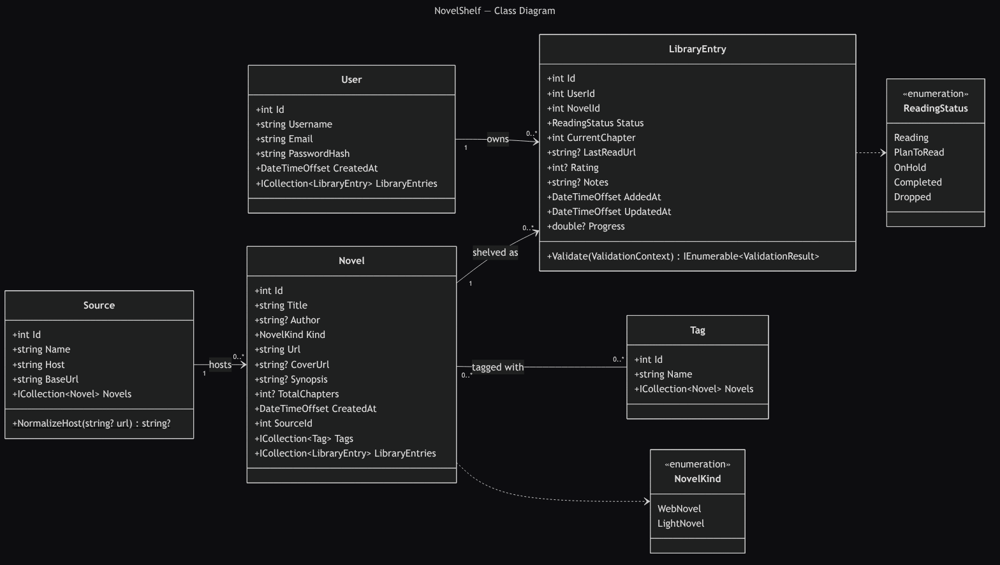
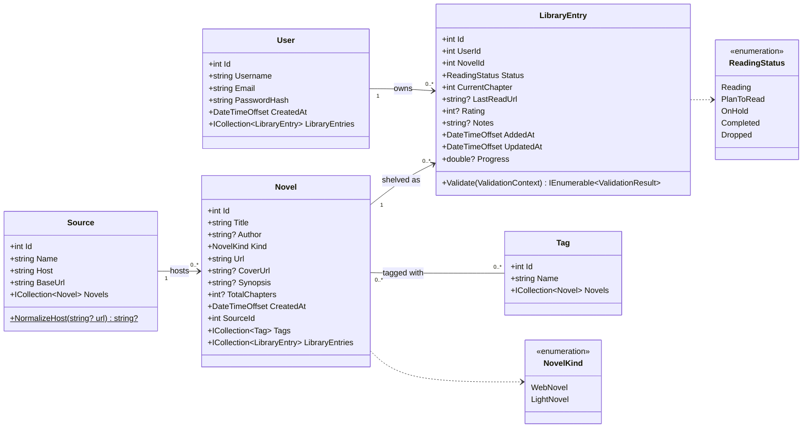

# NovelShelf Class Diagram

Planned database model for NovelShelf. The entity classes live in [`Models/Entities`](../Models/Entities). Until the database is added, the running app still stores the shelf in the browser through `Models/Novel.cs`.

PDF version: [class-diagram.pdf](class-diagram.pdf)

## Relationships

| Relationship | Multiplicity | Meaning |
| --- | --- | --- |
| User → LibraryEntry | 1 to 0..* | A user owns many shelf entries |
| Novel → LibraryEntry | 1 to 0..* | A novel can be on many users' shelves |
| Source → Novel | 1 to 0..* | A website hosts many novels |
| Novel ↔ Tag | 0..* to 0..* | Novels share genre tags (join table) |

`LibraryEntry` is the association class between `User` and `Novel`. It holds the reader's own status, chapter progress, rating and notes, so the same novel can be shared by many readers.

## Diagram source

